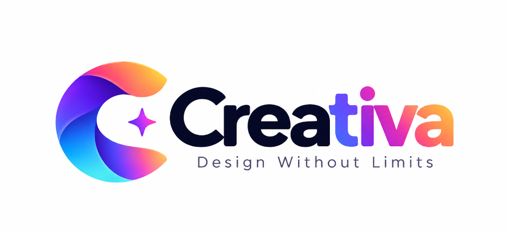

# Creativa — Free Online Graphic Design Platform & Magic Studio AI

<p align="center">
  
</p>

<p align="center">
  <strong>Design Without Limits. 100% Free, Open-Source Creative Platform Powered by React 19, Fabric.js v7, and Generative AI.</strong>
</p>

<p align="center">
  <a href="https://vercel.com/new/clone?repository-url=https://github.com/iamTechieAman/creativa"></a>
  
  
  
  
  
  
</p>

---

## 🌟 Highlights

- 🚀 **100% Client-Side Privacy Sandbox**: Your uploads and projects are stored exclusively in your local browser storage. No other user can ever access or view your files.
- 🪄 **Magic Studio™ Generative AI Suite**:
  - **Magic Design™**: Plain-text prompts generate complete, multi-element vector canvas layouts.
  - **Magic Media™**: Photorealistic 8K image generation powered by FLUX.1.
  - **Magic Write™**: Smart AI copywriting, tone shifting, and headline generation.
  - **Magic Morph™**: 3D materials and artistic textures for typography and elements.
  - **Magic Switch™**: Instant one-click multi-format resizing (Instagram Post, Story, YouTube, A4, Banner).
- 🎨 **900+ Fully Editable Design Templates**: Categorized across Presentations, Social Media, Marketing, Logos, Posters, Flyers, and Resumes.
- 👥 **700+ Verified Creators Hub**: Real-time directory of top designers with one-click profile inspection and published template collections.
- 📐 **Vector Artboard & Typography Engine**: 75+ Google Fonts, custom font pairings, letter-spacing, line-height, text shadows, and curve effects.
- 📱 **100% Responsive on All Devices**: Optimized for smartphones, tablets, laptops, and ultra-wide displays with zero horizontal overflow.
- 📦 **Multi-Format High-DPI Export**: PNG (transparent support, up to 300 DPI), JPEG, SVG (scalable vector paths), and PDF.

---

## 🚀 Quick Start (Local Setup)

### 1. Prerequisites
Ensure you have **Node.js 18+** installed:
```bash
node -v   # v18.0.0 or higher
```

### 2. Clone the Repository
```bash
git clone https://github.com/iamTechieAman/creativa.git
cd creativa
```

### 3. Install Dependencies
```bash
npm install
```

### 4. Run Development Server
```bash
npm run dev
```
Open **[http://localhost:3000](http://localhost:3000)** in your browser.

### 5. Build for Production
```bash
npm run build
```
Production assets are generated in the `dist/` directory in under 1 second.

---

## ⚡ 1-Click Deploy to Vercel

Deploy your own live instance of Creativa for free on Vercel with zero configuration:

[](https://vercel.com/new/clone?repository-url=https://github.com/iamTechieAman/creativa)

Creativa includes a ready-to-use [`vercel.json`](vercel.json) configured with SPA route rewrites, immutable static asset caching, and security headers.

---

## 🏗️ Architecture & Tech Stack

```
creativa/
├── public/                 # Static assets (favicons, logos, robots.txt, sitemap.xml)
├── src/
│   ├── components/         # React UI modules
│   │   ├── CreativaHomeModal.jsx    # Authentic Home screen dashboard
│   │   ├── MagicStudioView.jsx      # Generative AI Magic Studio Suite
│   │   ├── TemplatesHubView.jsx     # Searchable 900+ templates directory
│   │   ├── CreatorsDirectoryView.jsx# 700+ Verified designers community
│   │   ├── ProjectsWorkspaceView.jsx# Local private projects workspace
│   │   ├── CanvasStage.jsx          # Center Fabric.js drafting stage
│   │   ├── Header.jsx               # Top navigation & file actions
│   │   ├── Sidebar.jsx              # 14 Sidebar tool categories
│   │   ├── Drawer.jsx               # Expandable slide-out drawers
│   │   ├── ContextToolbar.jsx       # Floating contextual action bar
│   │   └── CreativaLogo.jsx         # Responsive vector brandmark
│   ├── data/               # Template databases, elements, fonts, creators
│   ├── utils/              # Canvas helpers, AI synthesis, export engines
│   ├── App.jsx             # Root application orchestrator
│   └── main.jsx            # React 19 entry point
├── vercel.json             # Vercel deployment & routing config
└── vite.config.js          # Vite build config with Tailwind CSS v4
```

### Core Technologies
- **UI Framework**: [React 19](https://react.dev/) + [Vite 8](https://vitejs.dev/)
- **Canvas Rendering**: [Fabric.js v7](https://fabricjs.com/) with sub-target group editability
- **Styling**: [Tailwind CSS v4](https://tailwindcss.com/)
- **Icons**: [Lucide React](https://lucide.dev/)
- **Document Export**: [jsPDF](https://github.com/parallax/jsPDF) + Native Canvas API
- **QR Engine**: [node-qrcode](https://github.com/soldair/node-qrcode)

---

## ⌨️ Keyboard Shortcuts Reference

| Shortcut | Action |
|---|---|
| `Ctrl + Z` / `Cmd + Z` | Undo last canvas action |
| `Ctrl + Y` / `Cmd + Shift + Z` | Redo action |
| `Ctrl + S` / `Cmd + S` | Save project locally |
| `Ctrl + D` / `Cmd + D` | Duplicate selected element |
| `Delete` / `Backspace` | Delete active element |
| `T` | Quick-insert Heading Textbox |
| `R` | Quick-insert Rectangle |
| `C` | Quick-insert Circle |
| `L` | Quick-insert Vector Line |
| `Escape` | Dismiss modal or clear active selection |

---

## 🤝 Contributing

Contributions make the open-source community an amazing place to learn, inspire, and create. Any contributions you make are **greatly appreciated**.

Please read our [Contributing Guidelines](CONTRIBUTING.md) and [Code of Conduct](CODE_OF_CONDUCT.md) before submitting a Pull Request.

1. Fork the Project
2. Create your Feature Branch (`git checkout -b feature/AmazingFeature`)
3. Commit your Changes (`git commit -m 'feat: add AmazingFeature'`)
4. Push to the Branch (`git push origin feature/AmazingFeature`)
5. Open a Pull Request

---

## ⚖️ Legal Disclaimer & Notice

- **Independent Project**: Creativa is an independent original open-source design platform developed by Aman Kumar for community creation, education, and visual design prototyping.
- **Trademark Notice**: All product names, logos, and brands are property of their respective owners. Any reference to formats or style concepts is strictly for identification and interoperability. Creativa is an independent creative platform and is not affiliated with, authorized, or endorsed by any external design software vendor.
- **Media Attribution**: Royalty-free imagery, stock vectors, and fonts belong to their respective creators under permissive Unsplash, Google Fonts, and CC0 licenses.

---

## 📄 License

Distributed under the **MIT License**. See [`LICENSE`](LICENSE) for more information.

---

<p align="center">
  Crafted with ❤️ by Aman Kumar and the Creativa Open Source Community.
</p>
